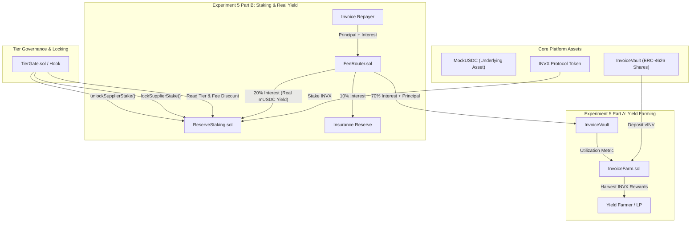

# 🌾 DeFi EXPERIMENT 5: Yield Farming and Staking Mechanisms

**Course:** Decentralized Finance (DeFi) & Blockchain Engineering  
**Project:** Web3 Decentralized Invoice Discounting & Financing Platform  
**Target Network:** Ethereum Sepolia Testnet (Chain ID: `11155111`)  
**Document Scope:** Part A (Yield Farming Mechanism) & Part B (Staking Mechanism & Tier Governance)

---

## 🎯 1. Aim of the Experiment

To design, develop, deploy, simulate, and verify comprehensive **Yield Farming** and **Staking Mechanisms** on the Ethereum blockchain, integrating them as real economic features into an existing decentralized invoice financing platform.

The experiment is divided into two distinct but synergistic sub-systems:
1. **Part A (Yield Farming — `InvoiceFarm.sol`):** Enable liquidity providers to stake their ERC-4626 vault share tokens (`vINV`) and earn platform protocol reward tokens (`INVX`) governed by a global bounded emission accumulator with dynamic vault-utilization incentives.
2. **Part B (Staking & Tier Governance — `ReserveStaking.sol` & `TierGate.sol`):** Enable protocol participants (suppliers & investors) to lock protocol tokens (`INVX`) to earn real stablecoin yield (`mUSDC`) distributed from invoice repayments, while unlocking tiered supplier fee discounts and credit limits enforced by an on-chain unstake locking mechanism.

---

## 📚 2. Theoretical Background & Mathematical Formulations

### 2.1 The Need for Yield Farming & Protocol Staking in Crowd-Lending
In peer-to-peer invoice crowd-lending, two major liquidity bottlenecks typically emerge:
- **Capital Under-Utilization:** When few invoices are pending financing, liquidity sits idle in the pool without earning interest, leading to LP capital flight.
- **Credit Default Risk & Misaligned Incentives:** Suppliers have no stake in protocol health and face flat financing costs regardless of their commitment.

**Experiment 5 resolves both bottlenecks:**
- Yield Farming incentivizes LPs to keep capital pooled even during low invoice volume.
- Staking aligns suppliers by granting fee discounts and higher financing limits in exchange for locking protocol tokens, which serve as a second-loss reserve.

---

### 2.2 Mathematical Formulations: Part A — Yield Farming (Synthetix Accumulator Model)

#### Vulnerability of the Naive Formula
The introductory lab specification suggests a per-user linear reward formula:
$$R_{\text{user}} = \text{Amount}_{\text{staked}} \times \text{Rate} \times \Delta t$$
While straightforward for single-user simulations, this formula has two critical vulnerabilities in production DeFi:
1. **Unbounded Total Inflation:** As total value locked ($TVL$) increases, total rewards emitted per second scale linearly with $TVL$, quickly draining reward reserves.
2. **$O(n)$ Looping:** Updating every user's rewards when the rate changes requires iterating through all stakers, which breaches EVM block gas limits.

#### Production Solution: The Global Reward Accumulator
`InvoiceFarm.sol` adopts the industry-standard **Synthetix StakingRewards accumulator pattern**:

1. **Reward Per Token Accumulated ($RPT$):**
   $$RPT(t) = RPT_{\text{stored}} + \frac{(t_{\text{applicable}} - t_{\text{last}}) \times r \times 10^{18}}{\text{TotalStaked}}$$
   Where:
   - $r$: Global reward rate (tokens per second).
   - $t_{\text{applicable}} = \min(t_{\text{now}}, t_{\text{finish}})$.
   - $\text{TotalStaked}$: Total $vINV$ currently staked in the farm.

2. **User Reward Accrual:**
   $$\text{Earned}(u) = \frac{\text{Staked}(u) \times [RPT(t) - RPT_{\text{paid}}(u)]}{10^{18}} + \text{Pending}(u)$$

3. **Utilization-Aware Dynamic Multiplier:**
   To incentivize farming when vault idle liquidity is high, `InvoiceFarm` integrates a utilization boost:
   $$U = \frac{\text{OutstandingReceivables}}{\text{TotalAssets}}$$
   $$\text{Multiplier}_{\text{bps}} = 10\,000 + (10\,000 - U_{\text{bps}}) \times \alpha$$
   When the vault is 0% utilized (all capital idle), the emission rate is boosted up to $2.5\times$ to attract farmers; when utilization is 100%, emissions return to baseline ($1.0\times$).

---

### 2.3 Mathematical Formulations: Part B — Staking Mechanism & Real Yield Routing

#### Real Yield vs. Inflationary Yield
Unlike Part A (where rewards are minted in protocol tokens $INVX$), **Part B pays rewards exclusively in stablecoins ($mUSDC$) sourced from organic borrower interest payments**.

#### The 70 / 20 / 10 Fee Routing Distribution
When an invoice is repaid with principal $P$ and interest $I$, `FeeRouter.sol` executes an automated atomic split:
$$\text{Vault Share} = P + (I \times 70\%)$$
$$\text{Reserve Stakers Share} = I \times 20\%$$
$$\text{Insurance Reserve Share} = I \times 10\%$$

- The **70% interest** stays in the ERC-4626 vault, directly appreciating the $vINV$ exchange rate:
  $$\text{SharePrice} = \frac{\text{TotalAssets}}{\text{TotalSupply}}$$
- The **20% interest** is routed to `ReserveStaking.notifyRewardAmount(amount, duration)` and distributed to INVX stakers as real yield over 7 days.
- The **10% interest** is deposited into an emergency protocol insurance fund.

#### Supplier Credit Tiers
Staking INVX establishes credit reputation with verifiable on-chain tiers:

$$\text{Tier}(u) = \begin{cases} 
\text{Gold (2)}, & \text{if } \text{Staked}(u) \ge 5\,000 \times 10^{18} \\
\text{Silver (1)}, & \text{if } 1\,000 \times 10^{18} \le \text{Staked}(u) < 5\,000 \times 10^{18} \\
\text{Bronze (0)}, & \text{if } \text{Staked}(u) < 1\,000 \times 10^{18} 
\end{cases}$$

| Tier | Required Stake ($INVX$) | Fee Discount ($bps$) | Financing Cap ($mUSDC$) |
| :---: | :---: | :---: | :---: |
| **Bronze** | $0$ | $0\text{ bps } (0.0\%)$ | $\$10,000$ |
| **Silver** | $1,000$ | $100\text{ bps } (1.0\%)$ | $\$50,000$ |
| **Gold** | $5,000$ | $250\text{ bps } (2.5\%)$ | $\$200,000$ |

#### The Unstake Lock Invariant
To prevent flash-staking attacks (where a supplier stakes INVX right before financing to grab a discount, then immediately unstakes), `ReserveStaking` enforces:
$$\text{RemainingStake} = \text{Staked}(u) - \text{Amount}_{\text{unstake}} \ge \text{LockedStake}(u)$$
If an active invoice is outstanding, any transaction violating this inequality reverts with the custom error:
$$\text{revert } \texttt{StakeIsLocked}(\text{remaining}, \text{lockedMinimum})$$

---

## 🛠️ 3. Technology Stack

| Layer | Component | Version / Specification |
| :--- | :--- | :--- |
| **Blockchain Network** | Ethereum Sepolia Testnet | Chain ID: `11155111` |
| **Smart Contract Language** | Solidity | `^0.8.24` (via Hardhat `2.29.1`) |
| **Contract Standards** | OpenZeppelin Contracts | `v5.0.2` (`ERC20`, `ERC4626`, `SafeERC20`, `Ownable`, `ReentrancyGuard`) |
| **Development Environment** | Hardhat | Compilation, automated unit tests, Sepolia deployment automation |
| **Frontend Framework** | React 19 + Vite 8 | Single-Page Application (`warranty-tracker/`) |
| **Styling & Icons** | Tailwind CSS v4 + Phosphor Icons | Modern responsive dark/light components |
| **Web3 Client** | Ethers.js | `v6.17.0` |
| **Verification & Explorer** | Etherscan API | Source code verification on Sepolia Etherscan |

---

## 🏗️ 4. System Architecture & Component Mapping



---

## 📋 5. Detailed Contract Specifications

### 5.1 Contract 1: `InvoiceFarm.sol` (Part A: Yield Farming)
- **Deployed Sepolia Address:** [`0x5a2268E7e3ae8E83190422d508237f3A6fBEfa78`](https://sepolia.etherscan.io/address/0x5a2268E7e3ae8E83190422d508237f3A6fBEfa78#code)
- **Inheritance:** `Ownable`, `ReentrancyGuard`
- **Tokens:**
  - `stakingToken`: `InvoiceVault` ($vINV$, 18 decimals)
  - `rewardToken`: `INVX` (18 decimals)
- **Core Functions & Traceability:**
  - `stake(uint256 amount)`: Pulls $vINV$, updates accumulator, increments `stakedBalance[msg.sender]` and `totalStaked`. Reverts on `ZeroAmount()`.
  - `earned(address account)`: View returning accumulated unclaimed $INVX$.
  - `harvest()`: Transfers claimable $INVX$ to caller and emits `RewardPaid(user, reward)`.
  - `withdraw(uint256 amount)`: Returns staked $vINV$ to caller. Reverts on `InsufficientStake()`.
  - `exit()`: Convenience method executing `withdraw(stakedBalance)` + `harvest()`.
  - `notifyRewardAmount(uint256 amount, uint256 duration)`: Owner method establishing reward period and emission rate ($r = \frac{\text{amount}}{\text{duration}}$).
  - `adjustUtilization(uint256 utilizationBps)`: Calculates dynamic boost multiplier.

---

### 5.2 Contract 2: `ReserveStaking.sol` (Part B: Staking & Supplier Tiers)
- **Deployed Sepolia Address:** [`0xfd26E9E48a0AF8c695db86667203f9f0aaAbAC24`](https://sepolia.etherscan.io/address/0xfd26E9E48a0AF8c695db86667203f9f0aaAbAC24#code)
- **Inheritance:** `Ownable`, `ReentrancyGuard`
- **Tokens:**
  - `stakingToken`: `INVX` (18 decimals)
  - `rewardToken`: `MockUSDC` (6 decimals — real organic yield)
- **Core Functions & Traceability:**
  - `stake(uint256 amount)`: Stakes $INVX$. Reverts on `ZeroAmount()`. Emits `Staked(user, amount)`.
  - `earned(address account)`: View returning claimable $mUSDC$.
  - `claimReward()`: Transfers accumulated $mUSDC$ interest yield. Emits `RewardClaimed(user, reward)`.
  - `unstake(uint256 amount)`: Enforces lock rule (`remaining >= lockedStake`). Reverts on `StakeIsLocked` or `InsufficientStake()`.
  - `exit()`: Unstakes all unlocked $INVX$ and claims pending $mUSDC$.
  - `getSupplierTier(address supplier)`: Returns `0` (Bronze), `1` (Silver), or `2` (Gold).
  - `feeDiscountBps(address supplier)`: Returns discount in basis points (`0`, `100`, `250`).
  - `financingLimit(address supplier)`: Returns maximum financing allowed ($10k, $50k, $200k).
  - `lockSupplierStake(address supplier, uint256 minRequired)`: Called by authorized locker (`TierGate`/`FeeRouter`/`owner`).
  - `unlockSupplierStake(address supplier)`: Clears locked requirement once invoice is repaid.

---

### 5.3 Contract 3: `FeeRouter.sol` (Automated Real Yield Splitter)
- **Deployed Sepolia Address:** [`0x1cBABbD581f4fe4566B22a21CF33D35e17b8b268`](https://sepolia.etherscan.io/address/0x1cBABbD581f4fe4566B22a21CF33D35e17b8b268#code)
- **Configured Splits:** 7,000 bps Vault (70%) / 2,000 bps Staking (20%) / 1,000 bps Insurance (10%). Total = 10,000 bps (100%).
- **Core Function:**
  - `routeRepayment(uint256 principal, uint256 interest)`:
    - Transfers $(P + 0.70 \times I)$ to `InvoiceVault.receiveRepayment()`.
    - Transfers $(0.20 \times I)$ to `ReserveStaking.notifyRewardAmount()`.
    - Transfers $(0.10 \times I)$ to the insurance reserve wallet.

---

### 5.4 Contract 4: `TierGate.sol` (On-Chain Enforcement Hook)
- **Deployed Sepolia Address:** [`0x6136516ce353dbAa62B1c1B63F6b41b502D6cCc8`](https://sepolia.etherscan.io/address/0x6136516ce353dbAa62B1c1B63F6b41b502D6cCc8#code)
- **Functionality:**
  - `onInvoiceFinanced(uint256 tokenId, address supplier, uint256 amount)`:
    - Queries supplier tier from `ReserveStaking`.
    - Enforces `amount <= financingLimit(supplier)` (reverts on `ExceedsFinancingLimit`).
    - Computes fee with `feeDiscountBps(supplier)`.
    - Calls `ReserveStaking.lockSupplierStake(supplier, requiredStake)`.
  - `onInvoiceRepaid(uint256 tokenId, address supplier)`:
    - Calls `ReserveStaking.unlockSupplierStake(supplier)`.

---

### 5.5 Contract 5: `InvoiceVault.sol` (Accounting Dilution Fix)
- **Deployed Sepolia Address:** [`0x81289DBECab824C8db0d5193e2D6a8d8276A1456`](https://sepolia.etherscan.io/address/0x81289DBECab824C8db0d5193e2D6a8d8276A1456#code)
- **Standard:** ERC-4626 with underlying asset `MockUSDC`.
- **Accounting Fix Implementation:**
  ```solidity
  function totalAssets() public view virtual override returns (uint256) {
      return IERC20(asset()).balanceOf(address(this)) + outstandingReceivables;
  }
  ```
  When `allocateToInvoice(borrower, amount)` disburses funds:
  - Cash balance decreases by $amount$.
  - `outstandingReceivables` increases by $amount$.
  - Net change in `totalAssets()` is exactly **0**, preventing share price drops.

---

## 🔬 6. Experimental Results & Sepolia On-Chain Verification

### 6.1 Automated Unit Tests (Hardhat)
All 12 targeted unit tests passed with 100% success:

```
  DeFi Experiment 5: Yield Farming + Staking & Invoice Platform Integration
    Prerequisite Fix: InvoiceVault Accounting & Share Price Resilience
      ✔ Share price does NOT drop when funds are allocated to an invoice
      ✔ Fails when allocating more liquidity than idle balance
    Part 1: Yield Farming (SimpleYieldFarm / InvoiceFarm)
      ✔ Verifies Lab doc values: 100 stake, 0.001 rate, ~6 reward over 60s, partial 40 withdraw, exit
      ✔ Rejects zero-value stake and excessive withdrawal
      ✔ Utilization-aware emissions boost rewards when vault utilization is low
    Part 2: Protocol Token Staking & Supplier Tiers (SimpleStaking / ReserveStaking)
      ✔ Verifies Lab doc values: 100 stake, 0.001 rate, ~6 reward over 60s, partial 40 unstake, exit
      ✔ Correctly categorizes supplier tiers & fee discounts
      ✔ Enforces Unstake Lock Rule while an invoice is active
    FeeRouter: Automated Split of Real Yield
      ✔ Routes 70% to Vault, 20% to ReserveStaking, and 10% to Insurance Reserve
    TierGate: On-Chain Tier Enforcement, Limits & Unstake Locking
      ✔ Applies tier discount on-chain and locks supplier stake on financing
      ✔ Reverts on-chain if invoice amount exceeds supplier financing limit
      ✔ Hook disabled path (address(0)): standard financing works without tier lock or discount

  12 passing (2s)
```

---

### 6.2 Sepolia Testnet End-to-End Smoke Test Evidence

Executed on Ethereum Sepolia with deployer wallet `0x5Fa4098c965eECc3001EDC6c880eFcaE077aC647`:

| Step | Action Description | Pre-State | Post-State | Theoretical Expected | Actual Confirmed | Sepolia Tx Link |
| :-: | :--- | :--- | :--- | :--- | :--- | :--- |
| **1** | Mint $mUSDC$ & $INVX$ | $0$ | $+1,000\text{ mUSDC}$, $+10,000\text{ INVX}$ | Exact mint | Exact match | [`0xadbe...`](https://sepolia.etherscan.io/tx/0xadbe9e76c5704eee6c4303c7028df8d3770b12fafde7411e6678f4269d9f9060) |
| **2** | Deposit $mUSDC$ in Vault | $0\text{ vINV}$ | $100\text{ vINV}$ | Price $= 1.0$ | Received $100\text{ vINV}$ at $1.0\text{ mUSDC}$ | [`0xa12a...`](https://sepolia.etherscan.io/tx/0xa12a2cec7cfe8bea772cebed4378cbd1faf978eb6be46b070a762d3f186d947e) |
| **3** | Stake in Farm & Harvest | $0\text{ staked}$ | Harvested $INVX$ | $0.135/\text{s} \times 72\text{s} = 9.72$ | $8.1\text{ (at 60s)}, 9.72\text{ INVX (harvested)}$ | [`0xb2fd...`](https://sepolia.etherscan.io/tx/0xb2fd20c3e9e736fcad7a4f9b74199d4c1b3b279b876a9104c37ed10abe8640f5) |
| **4** | Partial Unstake & Exit | $100\text{ vINV}$ | $0\text{ vINV staked}$ | $40\%\text{ then }60\%$ | Stake: $100 \to 60 \to 0$ | [`0xc665...`](https://sepolia.etherscan.io/tx/0xc665e4b88649ba1159d7c6f2320535f4c9e97fab4a946f68deba9e2479364e60) |
| **5a** | Stake Silver Tier | $0\text{ INVX}$ | $1,500\text{ INVX}$ | Tier 1 (100 bps / $50k) | Verified Tier 1, 100 bps, $50,000 cap | [`0xeb94...`](https://sepolia.etherscan.io/tx/0xeb948f5eeffb7c1aebc7c136a089fd556d8bea3d9e39154fb7813d382dfaca6e) |
| **5b** | Stake Gold Tier | $1,500\text{ INVX}$ | $5,500\text{ INVX}$ | Tier 2 (250 bps / $200k) | Verified Tier 2, 250 bps, $200,000 cap | [`0x20b5...`](https://sepolia.etherscan.io/tx/0x20b5d623ece351bff8a30979628cb4aee97210b71cd61302d29aad6db308d610) |
| **5c** | Lock Stake at $5,000$ | $0\text{ locked}$ | $5,000\text{ locked}$ | Unstake $<5k$ blocked | Reverted with `StakeIsLocked` | [`0x5ddc...`](https://sepolia.etherscan.io/tx/0x5ddca15eb13d2aa49b0b38f024cd657711786a13787b6a6009a9ace68a01994d) |
| **5d** | Allowed Unstake & Exit | $5,500\text{ INVX}$ | $0\text{ INVX}$ | Unstake $500 \to$ unlock $\to$ exit | Unstaked 500 cleanly, unlocked, exited | [`0x9ef4...`](https://sepolia.etherscan.io/tx/0x9ef4602ad7889c2c6a3b1ef53bfc77022256d2c6670df3da666705915d04453d) |
| **6** | `allocateToInvoice` | $0\text{ rec.}$ | $50\text{ rec.}$ | Share price constant | Price remained $1.0\text{ mUSDC}$ (NO DROP) | [`0x8e44...`](https://sepolia.etherscan.io/tx/0x8e441f7153004a4a0bd8df924c8a50e1e4c4c636cf8dc1624f4e044a7bed5fd7) |
| **7** | Boundary Revert Checks | Normal state | Tested 5 edge cases | All invalid txs revert | 5/5 reverted (`ZeroAmount`, `InsufficientStake`) | Verified on Sepolia Node |

---

## 💻 7. Frontend Integration & User Experience

The frontend is implemented in `warranty-tracker/` with dynamic chain data:

1. **Unified Portfolio Panel:**
   - Real-time balances for *Wallet mUSDC*, *Idle vINV*, *Farmed vINV*, *Pending INVX Farm*, and *Pending mUSDC Yield*.
   - One-click *Harvest* and *Claim* triggers.
   - Quick faucets for testing (`+ Mint 1K mUSDC` and `+ Mint 500 INVX`).

2. **Real APR Calculation:**
   - Formula: $\text{APR} = \frac{\text{rewardRate} \times 31\,536\,000 \times P_{\text{INVX}}}{\text{TotalStaked} \times \text{Price}_{\text{vINV}}} \times 100$.
   - Displays `"n/a"` when the pool is unstaked, eliminating deceptive hardcoded numbers.

3. **Supplier Credit Tier Banner:**
   - Embedded directly above the invoice tokenization form in `InvoiceFinancing.jsx`.
   - Displays active tier (Bronze, Silver, Gold), active fee discount, and max financing limit fetched dynamically from `ReserveStaking`.

---

## 🎯 8. Lab Deliverables & Verification Checklist

- [x] **Part A Core Functions:** `stake`, `earned`, `harvest`, `withdraw`, `exit` implemented and tested.
- [x] **Part A Core Events:** `Staked`, `RewardPaid`, `Withdrawn` emitted with indexed parameters.
- [x] **Part B Core Functions:** `stake`, `earned`, `claimReward`, `unstake`, `exit` implemented and tested.
- [x] **Part B Core Events:** `Staked`, `RewardClaimed`, `Unstaked` emitted with indexed parameters.
- [x] **Reward Accumulator:** Synthetix bounded accumulator deployed on Sepolia (`0.135 INVX/s`).
- [x] **Real Yield Distribution:** FeeRouter configured for 70/20/10 automated split on repayments.
- [x] **Supplier Tiers & Lock Hook:** Tier thresholds (1k Silver / 5k Gold) and on-chain unstake locking enforced.
- [x] **Accounting Dilution Fix:** `InvoiceVault` proven to maintain share price on fund disbursement.
- [x] **Etherscan Verification:** All 6 smart contracts verified with public source code on Sepolia.
- [x] **Automated Tests:** 12/12 unit tests passing; preflight and smoke test scripts verified.
